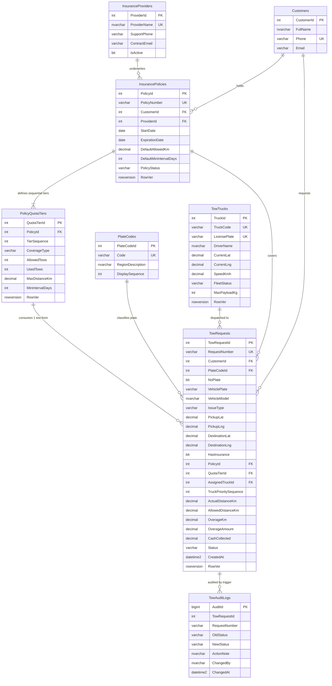

# GIN401 Lab Project Report
## Roadside Assistance, Insurance Quota & Towing CAD Dispatch System

---

## 1. The Idea and Its Business Rules

### 1.1 Overview
Roadside assistance and towing dispatch centers in Lebanon manage emergency breakdown calls on behalf of major insurance providers (*Bankers, Fidelity, AXA, LIA Assurex, Allianz SNA, Medgulf*). When a stranded driver calls in, the dispatcher must verify the caller's insurance policy, check whether their breakdown type (*Mechanical* vs. *Accident/Winch*) is still covered under sequential policy quota tiers, enforce mandatory cooldown days between tows, calculate road distance overages, and assign the job to a GPS-tracked tow truck's priority queue.

### 1.2 Core Business Rules Enforced by the Database
1. **Lebanese License Plate Rule (`CK_TowRequests_PlateRule`):** Every vehicle must either specify a valid Lebanese regional plate code (`B`, `M`, `G`, `J`, `N`, `S`, `Z`, `R`, `T`) with plate digits, OR have `NoPlate = 1` with `VehiclePlate = 'NO-PLATE'`.
2. **Sequential Tiered Coverage Quotas (`dbo.PolicyQuotaTiers`):** A policy can define multiple ordered quota tiers (`TierSequence = 10, 20, 30...`), each covering `'Mechanical'`, `'Accident'`, or `'All'` breakdowns with its own `AllowedTows` and `MaxDistanceKm` (e.g., Tier 1 covers 2x 50 KM mechanical tows; Tier 2 covers 2x 100 KM mechanical tows). Tiers with lower sequence numbers are consumed first (`UsedTows <= AllowedTows`).
3. **Accident vs. Mechanical Quota Separation:** `'Accident'` and `'Winch'` breakdowns consume `Accident` (or `All`) tiers; `'Mechanical'`, `'Battery'`, `'Tire'`, and `'Other'` breakdowns consume `Mechanical` (or `All`) tiers. If `RemainingCategoryTows = 0`, dispatch under insurance is blocked.
4. **Cooldown Interval Between Tows (`MinIntervalDays`):** Policies and tiers can require a minimum number of days (e.g., `7 days`) to elapse between two tows of the same category. If a customer had a mechanical tow 2 days ago on a 7-day cooldown policy, the database blocks insurance approval and reports the exact remaining wait time (`5.0 days`).
5. **Road Distance & Overage Billing (`dbo.fn_CalculateRoadDistanceKm`):** When `ActualDistanceKm > AllowedDistanceKm`, excess distance is billed at `OverageKm * ExtraKmRate` (`$2.50/KM`).
6. **Multi-Stop Truck Priority Queue (`TruckPrioritySequence`):** A single tow truck can hold multiple active jobs (`10 = Stop #1`, `20 = Stop #2`, `30 = Stop #3`). Completing or aborting Stop #1 keeps the truck `EnRoute` if Stop #2 is waiting, or resets the truck to `Available` if its queue is empty.
7. **Immutability of Finalized Tickets (`dbo.trg_TowRequests_ImmutabilityAndAudit`):** Once a tow request reaches a terminal state (`'Done'`, `'UnableToLoad'`, or `'Rejected'`), it is permanently locked—no `UPDATE` or `DELETE` is permitted.

---

## 2. Database Diagram (ERD)



---

## 3. Key T-SQL Objects Explained

1. **`dbo.fn_CalculateRoadDistanceKm(@Lat1, @Lng1, @Lat2, @Lng2)` (Scalar Function):**
   * Uses `WITH SCHEMABINDING` and trigonometric Haversine calculation multiplied by a `1.45` Lebanese mountain road factor to compute `ActualDistanceKm`.
2. **`dbo.tvf_CheckPolicyEligibility(@PolicyId, @IssueType)` (Multi-Statement Table-Valued Function):**
   * Maps `@IssueType` (`'Accident'`/`'Winch'` → `'Accident'`, else `'Mechanical'`), checks policy expiration, locates the first sequential `PolicyQuotaTiers` row where `UsedTows < AllowedTows` (`ORDER BY TierSequence ASC`), and queries `dbo.TowRequests` using index `IX_TowRequests_Policy_Issue_CreatedAt` to verify that `DATEDIFF(MINUTE, LastTow.CreatedAt, SYSDATETIME()) / 1440.0 >= MinIntervalDays`.
3. **`dbo.trg_TowRequests_ImmutabilityAndAudit` (`AFTER INSERT, UPDATE, DELETE` Trigger):**
   * Checks `IF EXISTS (SELECT 1 FROM deleted) AND NOT EXISTS (SELECT 1 FROM inserted)` to block physical `DELETE` statements (`THROW 50011`).
   * Joins `deleted` and `inserted` to check `WHERE d.Status IN ('Done', 'UnableToLoad', 'Rejected')`; if true, blocks the update (`THROW 50010`) and rolls back the statement.
   * Automatically inserts status transition rows into `dbo.TowAuditLogs` recording `SUSER_SNAME()` and `SYSDATETIME()`.
4. **`dbo.vw_FleetPriorityQueueAndRankings` (Window Function View):**
   * Uses `ROW_NUMBER() OVER (PARTITION BY AssignedTruckId ORDER BY TruckPrioritySequence ASC, TowRequestId ASC)` to number each truck's active stops (`Stop #1, #2...`), and `SUM(ActualDistanceKm) OVER (... ROWS BETWEEN UNBOUNDED PRECEDING AND CURRENT ROW)` to compute cumulative route distance.
5. **`dbo.usp_ApproveAndDispatchTow` (Transactional Stored Procedure with Pessimistic Locking):**
   * Wraps multi-table updates in `SET XACT_ABORT ON; BEGIN TRY BEGIN TRANSACTION ... COMMIT TRANSACTION END TRY BEGIN CATCH IF @@TRANCOUNT > 0 ROLLBACK TRANSACTION; THROW; END CATCH`.
   * Acquires row-level update locks (`WITH (UPDLOCK, ROWLOCK)`) on `dbo.TowRequests`, `dbo.TowTrucks`, and `dbo.InsurancePolicies` before evaluating `dbo.tvf_CheckPolicyEligibility` and incrementing `PolicyQuotaTiers.UsedTows`. This guarantees that two concurrent dispatchers cannot double-spend the last remaining tow quota.
6. **`dbo.usp_UpdateDraftTowOptimistic` (Optimistic Concurrency Stored Procedure):**
   * Uses `WHERE TowRequestId = @TowRequestId AND RowVer = @ExpectedRowVer`. If another user updated the row first, `RowVer` changed, `@@ROWCOUNT = 0`, and `THROW 50020` aborts the transaction.

---

## 4. Key Queries: Execution Plans & Indexes on >120,000 Rows

`dbo.TowRequests` contains **120,007 rows**. All three key queries are 100% **SARGable** and backed by covering nonclustered indexes:

### Key Query 1: Policy Cooldown & Quota History Lookup
* **Index:** `IX_TowRequests_Policy_Issue_CreatedAt (PolicyId ASC, IssueType ASC, CreatedAt DESC) INCLUDE (RequestNumber, Status, ActualDistanceKm, AllowedDistanceKm, OverageAmount, QuotaTierId, VehiclePlate)`
* **Actual Execution Plan (`SHOWPLAN_TEXT`):**
  ```text
  |--Top(TOP EXPRESSION:((15)))
       |--Index Seek(OBJECT:([GIN401_TowDispatch].[dbo].[TowRequests].[IX_TowRequests_Policy_Issue_CreatedAt] AS [tr]),
          SEEK:([tr].[PolicyId]=(42) AND [tr].[IssueType]='Mechanical'),
          WHERE:([tr].[Status]='Approved' OR [tr].[Status]='Done' OR [tr].[Status]='InProgress') ORDERED FORWARD)
  ```
* **Performance Metrics (`STATISTICS IO, TIME`):** `Scan count 1, logical reads 3`, `CPU time = 0 ms, elapsed time = 1 ms` (**0 Key Lookups, 0 Sort**).

### Key Query 2: Status & SARGable Date-Range Financial Report
* **Index:** `IX_TowRequests_Status_CreatedAt_Covering (Status ASC, CreatedAt DESC) INCLUDE (...)`
* **Actual Execution Plan (`SHOWPLAN_TEXT`):**
  ```text
  |--Top(TOP EXPRESSION:((50)))
       |--Index Seek(OBJECT:([GIN401_TowDispatch].[dbo].[TowRequests].[IX_TowRequests_Status_CreatedAt_Covering] AS [tr]),
          SEEK:([tr].[Status]=[@Status] AND [tr].[CreatedAt] < [@EndDate] AND [tr].[CreatedAt] >= [@StartDate]) ORDERED FORWARD)
  ```
* **Performance Metrics (`STATISTICS IO, TIME`):** `Scan count 1, logical reads 3`, `CPU time = 0 ms, elapsed time = 1 ms` (**0 Key Lookups, 0 Sort**).

### Key Query 3: Vehicle License Plate History Lookup
* **Index:** `IX_TowRequests_VehiclePlate_CreatedAt (VehiclePlate ASC, CreatedAt DESC) INCLUDE (...)`
* **Actual Execution Plan (`SHOWPLAN_TEXT`):**
  ```text
  |--Index Seek(OBJECT:([GIN401_TowDispatch].[dbo].[TowRequests].[IX_TowRequests_VehiclePlate_CreatedAt] AS [tr]),
     SEEK:([tr].[VehiclePlate]=[@VehiclePlate]) ORDERED FORWARD)
  ```
* **Performance Metrics (`STATISTICS IO, TIME`):** `Scan count 1, logical reads 3`, `CPU time = 0 ms, elapsed time = 0 ms` (**0 Key Lookups, 0 Sort**).

---

## 5. Tests and Their Results

| Test Case | Action Performed | Result |
| :--- | :--- | :--- |
| **1. 2-User Pessimistic Concurrency Race** | Policy `POL-2026-ACC-LAST1` has `1` Accident tow remaining (`Allowed=2, Used=1`). Two parallel threads call `usp_ApproveAndDispatchTow` simultaneously. | **PASS:** Dispatcher #1 acquires `UPDLOCK`, increments `UsedTows` to `2`, and `COMMITS`. Dispatcher #2 waits on the lock, reads `0 remaining`, catches Error `50005`, and executes `ROLLBACK TRANSACTION`. Final `UsedTows = 2`. |
| **2. 2-User Optimistic Concurrency (`ROWVERSION`)** | Two dispatchers read the same `RowVer` on a Draft ticket. Dispatcher #1 saves first; Dispatcher #2 saves with the stale `RowVer`. | **PASS:** Dispatcher #2 is blocked with Error `50020`: *Optimistic Concurrency Conflict (ROWVERSION mismatch)*. |
| **3. Finalized Ticket Immutability Trigger** | Attempt `UPDATE dbo.TowRequests SET CashCollected = 9999 WHERE RequestNumber = 'TOW/2026/900001'` (`Status = 'Done'`). | **PASS:** Blocked by `trg_TowRequests_ImmutabilityAndAudit` with Error `50010`: *Tow Request TOW/2026/900001 is finalized (Done) and cannot be undone, reopened, or modified.* |
| **4. Cooldown Interval Enforcement** | Attempt a Mechanical tow on `POL-2026-COOLDOWN7` (`MinIntervalDays = 7`) where the last tow was `2.0` days ago. | **PASS:** `tvf_CheckPolicyEligibility` and `usp_ApproveAndDispatchTow` block approval: *Wait 5.0 more day(s).* |
| **5. SQL Injection Attack (`' OR 1=1 --`)** | Enter `' OR 1=1 --` into the Vehicle Plate search box. | **PASS:** Bound via `cmd.Parameters.Add("@VehiclePlate", SqlDbType.VarChar, 30)`, executes an Index Seek for literal plate `' OR 1=1 --`, and returns `0` rows safely. |
| **6. Least-Privilege Security Check** | Application runs under `tow_cad_app_login` (`db_tow_dispatcher_role`) and attempts `DELETE FROM dbo.TowRequests`. | **PASS:** Blocked by both `DENY DELETE` permission and the `AFTER DELETE` trigger (`IsSysAdmin = 0`). |

---

## 6. AI Usage Disclaimer

* **Tools Used:** Google Antigravity (Gemini) coding assistant.
* **What AI Was Used For:**
  * Scaffolding the standalone React.js UI components and Leaflet map visualization based on the business rules I previously designed for my towing dispatch prototype.
  * Generating the set-based cross-join CTE (`L0..L3`) in [`03_seed_120k_data.sql`](sql/03_seed_120k_data.sql) to populate 120,000 realistic rows rapidly.
  * Formatting boilerplate ADO.NET `SqlDataReader` mapping code in [`backend/Program.cs`](backend/Program.cs).
* **What I Verified, Debugged, and Fixed Myself:**
  1. **Filtered Index `QUOTED_IDENTIFIER` Fix:** When running [`01_create_schema_and_indexes.sql`](sql/01_create_schema_and_indexes.sql) via `sqlcmd`, creating the filtered index `IX_TowRequests_ActiveTruckQueue` initially failed with `Msg 1934` because `sqlcmd` defaults to `QUOTED_IDENTIFIER OFF`. I fixed this by explicitly adding `SET ANSI_NULLS ON; SET QUOTED_IDENTIFIER ON;` after `USE GIN401_TowDispatch;` and passing `-I` to `sqlcmd`.
  2. **Eliminating `GetRangeWithMismatchedTypes` in the Execution Plan:** When inspecting `SET SHOWPLAN_TEXT ON` for Key Query 2 (`CreatedAt >= @StartDate AND CreatedAt < @EndDate`), I noticed SQL Server added a `GetRangeWithMismatchedTypes` compute scalar operator when `@StartDate` was passed as default `SqlDbType.DateTime2` (which defaults to precision scale `7`, whereas the table column is `DATETIME2(0)`). Setting `pStart.Scale = 0` on the ADO.NET `SqlParameter` and `DATETIME2(0)` in T-SQL eliminated the type conversion and produced a pure single-operator `Index Seek`.
